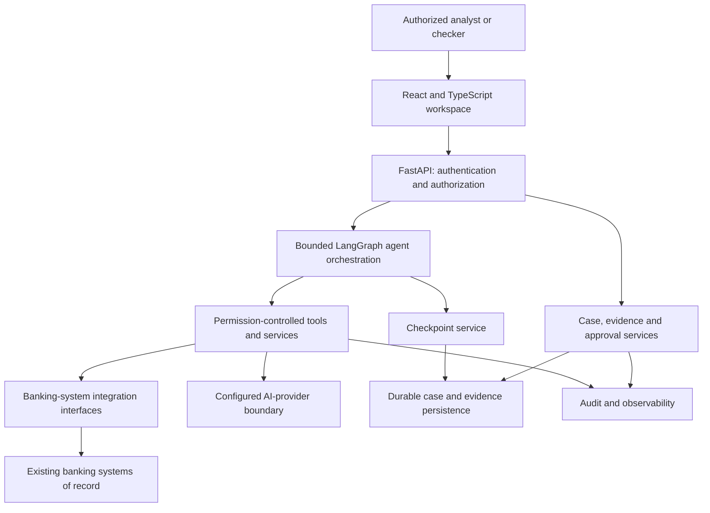

# Architecture Brief

[Back to the client package](../README.md)

This is a high-level explanation of the documented application architecture.
It is not a deployment manifest, a bank connectivity certificate or evidence
that every component was exercised by the short recording.

## Logical Components

## Responsibilities

| Component | Responsibility |
| --- | --- |
| Web workspace | Present cases, evidence, advisory findings and review controls |
| API boundary | Authenticate requests and enforce authorization |
| Domain services | Own banking workflow rules, approvals and case state |
| Agent runtime | Coordinate bounded investigation steps and human interruptions |
| Tools and integration interfaces | Retrieve permitted data and expose explicit service operations |
| Persistence and checkpoint services | Preserve application state, evidence and recoverable workflow progress |
| AI-provider boundary | Access configured models without treating model output as authority |
| Audit and observability | Record decision context and operational outcomes |

The documented stack includes Python, FastAPI, LangGraph, PostgreSQL, Redis,
object storage, React and TypeScript. The bank's deployment topology, identity
provider, model hosting and data-residency requirements need separate agreement.

## Control Boundaries

- The frontend does not bypass API authorization.
- Agents use tools and services; they do not directly access business databases.
- Tools return data or expose controlled operations; they do not make banking
  decisions independently.
- Domain logic does not directly call model APIs; model use belongs behind the
  agent runtime and provider boundary.
- Integration and provider paths fail closed when required configuration,
  evidence or authority is unavailable.
- Facts, calculations, AI inferences, human decisions and executed actions
  remain distinguishable in the workflow.
- Maker-checker approval and audit recording are not optional demo shortcuts.

## What an Integration Requires

Each bank must establish approved connectivity, service identities, data
contracts, permissions, policy ownership and reconciliation behavior. An
implemented adapter interface is not equivalent to certified or production-tested
connectivity with that institution.

AI output is advisory. Sanctions decisions, final credit decisions, regulatory
filings and funds movement require the institution's independently authorized
controls and systems.

See [Demo Guide and Readiness Notes](DEMO_GUIDE.md) for the demonstrated boundary
and pilot acceptance questions.